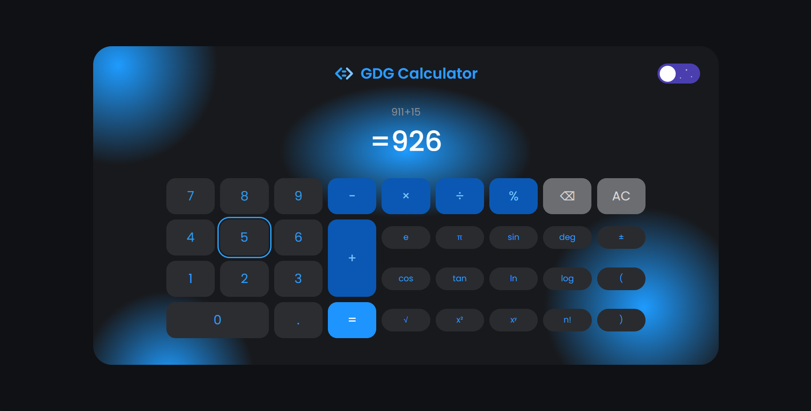
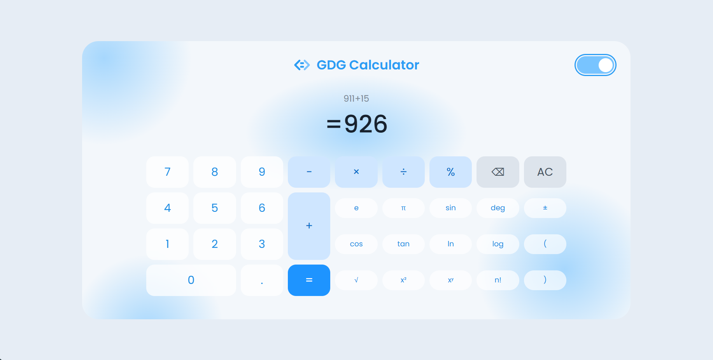

# GDG Calculator

**GDG Challenge 1 – Task 2:** A responsive scientific calculator built with HTML, CSS, and vanilla JavaScript, based on a Figma design.

- **Live Demo:** [Try the calculator](https://wchibout.github.io/gdg-calculator/)
- **Figma Design:** [Calculator App UI Design](https://www.figma.com/design/gydXtggAWOeogtbXclIf3m/Calculator-App-Ui-Design-Download-Free--Community-)
- **Author:** CHIBOT Wahb

## Screenshots

| Desktop — Dark Mode | Desktop — Light Mode |
|---|---|
|  |  |

## About

GDG Calculator is a responsive scientific calculator designed for desktop and mobile devices, with both dark and light themes.

Inspired by the provided Figma design, it features a dark frame, glowing blue accents, rounded keys, and a live result display. The repeated function buttons in the original design were replaced with functional scientific operations.

## Features

- **Basic operations:** Addition, subtraction, multiplication, division, percentages, sign change, backspace, and clear (`AC`).
- **Scientific functions:** `sin`, `cos`, `tan`, `ln`, `log`, `√`, `x²`, `xʸ`, `n!`, `π`, `e`, and parentheses.
- **Degrees and radians:** Switch the angle mode for trigonometric functions.
- **Live result:** The result updates while entering an expression, with large numbers formatted using commas.
- **Dark and light themes:** Switch themes and remember the selected preference in the browser.
- **Responsive design:** Layouts for desktop, mobile portrait, and mobile landscape.
- **Keyboard support:** Enter expressions using the keyboard. Press `Enter` or `=` to calculate, `Backspace` to delete, and `Esc` or `Delete` to clear.
- **Error handling:** Invalid expressions and mathematical errors display an error message.

## Technologies

- **HTML5** — Page structure and calculator interface.
- **CSS3** — Grid layout, custom properties, and responsive media queries.
- **Vanilla JavaScript** — Calculator logic, expression parsing, and theme switching.
- **Google Fonts** — Poppins typography.

## Project Structure

```text
gdg-calculator/
├── images/
│   ├── desktop-dark.png
│   └── desktop-light.png
├── index.html
├── style.css
├── script.js
└── README.md
```

## How to Run

1. Clone or download this repository.
2. Open `index.html` in a modern web browser.
3. Start calculating!

```bash
git clone https://github.com/wchibout/GDG-calculator.git
```

No installation or additional libraries are required to run the calculator locally.

## How It Works

### Expression Parser

Instead of using JavaScript's `eval()`, the calculator uses a custom recursive-descent parser in `script.js`. It handles operator precedence, parentheses, scientific functions, percentages, factorials, and implicit multiplication such as `2π` or `3(4+1)`.

### Theme Management

CSS custom properties define the colors used by both themes. JavaScript switches between dark and light modes, and the selected preference is stored in the browser.

### Responsive Layout

CSS Grid and media queries adapt the interface to different screen sizes. On desktop, the scientific function keys sit beside the number keypad; on mobile, the function keys appear in a swipeable row above it.

## What I Learned

- Translating a Figma design into a functional web application.
- Building responsive layouts with CSS Grid and media queries.
- Implementing a mathematical expression parser without `eval()`.
- Managing dark and light themes using CSS custom properties.
- Handling user input and mathematical errors.

## Possible Improvements

- Calculation history.
- Additional functions, including inverse trigonometry and modulo.
- More mathematical constants and operations.
- Progressive Web App (PWA) support for mobile installation.